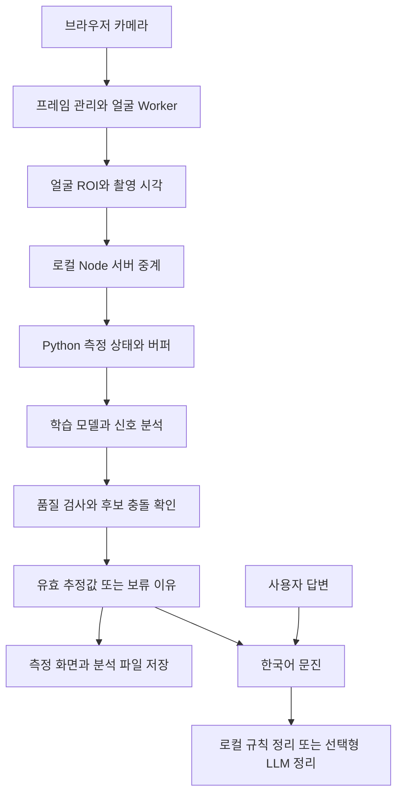

# 카메라에서 측정과 문진으로 이어지는 구조

입력은 웹캠 얼굴 영상과 사용자의 문진 응답입니다. 출력은 품질 검사를 통과한 심박·호흡 추정값, 실패하거나 보류한 이유, 답변을 정리한 문진 결과입니다.

## 두 서버의 역할

브라우저는 `localhost:5500`에 연결합니다. Node 서버는 화면을 제공하고 같은 출처의 측정·문진 요청을 로컬 Python 서버로 전달합니다. Python의 `app.py`가 API와 세션을, `pipeline.py`가 시간에 따른 수집·분석을 담당합니다. 모델 가중치 확인과 로딩은 `models.py`, 공식 파일 준비는 `setup_models.py`에 있습니다.

## 수치가 표시되는 과정

1. 얼굴이 안정적으로 보이는지 확인하고 준비 5초 후 수집을 시작합니다.
2. 초기 심박 분석은 수집 12초부터, 초기 호흡 분석은 20초부터 시작합니다. 기본 60초 수집 후 최종 결과를 정리합니다.
3. 프레임 공백·신호 품질 부족·후보 충돌이 있으면 수치를 보류합니다. 스펙트럼에서 어떤 숫자가 계산되었다고 해서 반드시 유효한 결과가 되는 것은 아닙니다.
4. 실패 이유와 개발용 판정 근거를 표시하고, 사용자가 요청하면 최종 분석 파형을 JSON으로 저장합니다.

학습 모델은 EfficientPhys·MTTS-CAN이며 CHROM·POS를 비교 기준으로 사용합니다. BiPulseFormer는 연구 후보로 언급되지만 이 저장소에 구현·가중치가 포함되어 있지 않습니다.

## 문진과 정보 처리

문진은 서버가 발급한 결과 ID를 사용합니다. LLM은 측정값을 생성하는 모델이 아니라 준비된 사실을 정리하는 선택 기능입니다. 기본 로컬 규칙 문진은 외부 API 없이 동작하고, 외부 LLM에 요약·응답을 보낼 때는 사용자의 동의를 받습니다.

카메라 ROI는 로컬 추론 경로에서 처리하며 LLM으로 보내지 않습니다. 사용자가 직접 저장한 분석 파일에는 파형과 판정 근거가 포함되며 얼굴 픽셀과 문진 답변은 포함하지 않습니다. 세부 보존·만료 방식은 [첫 화면](../README.md)의 설명과 서버 코드를 함께 확인하세요.

## 현재 확인된 범위

기존 자동 검사는 수집 상태·신호 후보·모델 출력·문진·UI의 동작을 다룹니다. 실제 기준 장치와 동시 측정한 정확도, 젯슨 실기기 성능, 로컬 LLM 성능은 별도 검증이 필요합니다. 이번 문서 보완에서 해당 성능을 새로 측정하지 않았습니다.

[파일별 역할](FILE_GUIDE.md) · [기존 검증 기록](../chambit_health_demo/VALIDATION.md)

## 코드 위치

| 파일 | 책임 |
|---|---|
| `chambit_health_demo/index.html`, `style.css` | 화면과 레이아웃 |
| `measurement-controller.mjs` | 카메라·Worker·WebSocket 생명주기, 취소·재측정 |
| `measurement-worker.mjs` | 얼굴 추적, 얼굴 영역과 색 신호 추출 |
| `frame-pump.mjs` | 실제 프레임 대기 관리, 수신·처리 속도 계측 |
| `measurement-ui.mjs`, `measurement-timeline.mjs` | 값·파형·진행 막대·분석 파일 저장 |
| `consultation-ui.mjs` | 문진 화면과 서버 요청 |
| `server.js`, `dev.mjs` | 정적 파일·API 중계, 웹·추론 서버 동시 실행 |
| `inference/app.py` | FastAPI, 측정 세션, 결과 ID, 문진 API |
| `inference/pipeline.py` | 시간 구간 관리, 추론 스케줄, 모델 출력 통합 |
| `inference/models.py` | 모델 어댑터, 가중치 검증, PyTorch·ONNX 실행 |
| `inference/signals.py`, `feedback.py` | 수치 계산·후보 검증과 사용자용 실패 설명 |
| `inference/consultation.py` | 질문 흐름, 고정 안내, 선택형 LLM 연동 |
| `inference/replay.py`, `evaluate.py`, `benchmark.py` | 영상 재생, 오차 평가, 합성 입력 성능 검사 |
| `inference/export_models.py` | ONNX 변환과 출력 비교 |

첫 행을 제외한 프런트엔드 파일은 모두 `chambit_health_demo/` 아래에 있습니다.

## 측정 규칙

- 준비 5초 후 수집 60초, 최대 시도 120초입니다.
- 초기 심박 분석은 수집 12초부터 2초 간격, 초기 호흡 분석은 20초부터 5초 간격입니다.
- 짧은 구간은 3주기 이상·필터 전 대역 에너지 0.5 이상·기존 엄격 품질 조건을 통과해야
  preliminary 상태로 표시합니다. 최종 계산에는 초기값을 재사용하지 않고 최소 20초·35초를 적용합니다.
  분석 시작 시점은 수치 표시를 보장하지 않습니다.
- 실제 촬영 시각을 유지합니다. 긴 공백이나 얼굴 이탈로 구간이 초기화되면 이전 결과를 폐기합니다.
- 학습 모델 입력 조건은 실제 24fps 이상과 최대 100ms 프레임 간격입니다.
- 추론은 실행 중 하나와 대기 중 최신 하나로 제한합니다. EfficientPhys는 완료된 작은 구간을 캐시합니다.
- MTTS-CAN은 연속 구간 전체를 한 번 정규화한 뒤 180프레임 배치로 계산합니다.
  호흡 갱신과 최종 분석 때 실행하며 완전히 같은 구간의 출력만 재사용합니다.
- HR/RR은 독립적으로 성공·실패합니다. 서로 다른 지표나 호환되지 않는 후보를 평균하지 않습니다.
- 실패 시 데모 수치로 자동 전환하지 않습니다. 가상 데이터는 명시적으로 선택해야 합니다.

## 데이터 보관과 신뢰 경계

얼굴 ROI는 로컬 메모리에서 처리하고 자동으로 파일에 저장하지 않습니다. 서버의 측정·문진
결과는 30분 후 만료되며 각각 최대 100개 세션을 유지합니다. 사용자가 내려받은 수치·파형
분석 파일은 기기에 남고, 얼굴 영상·ROI 픽셀·문진 답변은 포함하지 않습니다.

문진은 화면 문자열이나 클라이언트가 만든 생체 수치 대신 서버의 확정 결과 ID를 참조합니다.
외부 LLM은 사용자가 전송에 동의했을 때만 정리할 정보를 받습니다. 영상은 전송하지 않고,
키는 서버에 보관합니다. 잘못된 응답이나 15초 시간 초과 시 규칙 문진으로 진행합니다.

자세한 모델 출처와 전처리 차이는 [모델 안내](../inference/NOTICE.md)를 참고합니다.
