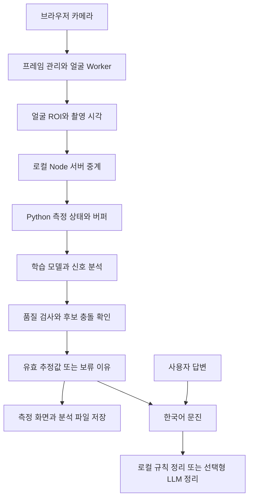

# 카메라에서 측정과 문진으로 이어지는 구조

입력은 웹캠 얼굴 영상과 사용자의 문진 응답입니다. 출력은 품질 검사를 통과한 심박·호흡 추정값, 실패하거나 보류한 이유, 답변을 정리한 문진 결과입니다.

## 두 서버의 역할

브라우저는 `localhost:5500`에 연결합니다. Node 서버는 화면을 제공하고 같은 출처의 측정·문진 요청을 로컬 Python 서버로 전달합니다. Python의 `app.py`가 API와 세션을, `pipeline.py`가 시간에 따른 수집·분석을 담당합니다. 모델 가중치 확인과 로딩은 `models.py`, 공식 파일 준비는 `setup_models.py`에 있습니다.

## 수치가 표시되는 과정

1. 얼굴이 안정적으로 보이는지 확인하고 준비 5초 후 수집을 시작합니다.
2. 심박 분석은 수집 20초부터, 호흡 분석은 35초부터 시작합니다. 60초 수집 후 최종 결과를 정리합니다.
3. 프레임 공백·신호 품질 부족·후보 충돌이 있으면 수치를 보류합니다. 스펙트럼에서 어떤 숫자가 계산되었다고 해서 반드시 유효한 결과가 되는 것은 아닙니다.
4. 실패 이유와 개발용 판정 근거를 표시하고, 사용자가 요청하면 최종 분석 파형을 JSON으로 저장합니다.

학습 모델은 EfficientPhys·MTTS-CAN이며 CHROM·POS를 비교 기준으로 사용합니다. BiPulseFormer는 연구 후보로 언급되지만 이 저장소에 구현·가중치가 포함되어 있지 않습니다.

## 문진과 정보 처리

문진은 서버가 발급한 결과 ID를 사용합니다. LLM은 측정값을 생성하는 모델이 아니라 준비된 사실을 정리하는 선택 기능입니다. 기본 로컬 규칙 문진은 외부 API 없이 동작하고, 외부 LLM에 요약·응답을 보낼 때는 사용자의 동의를 받습니다.

카메라 ROI는 로컬 추론 경로에서 처리하며 LLM으로 보내지 않습니다. 사용자가 직접 저장한 분석 파일에는 파형과 판정 근거가 포함되며 얼굴 픽셀과 문진 답변은 포함하지 않습니다. 세부 보존·만료 방식은 [첫 화면](../README.md)의 설명과 서버 코드를 함께 확인하세요.

## 현재 확인된 범위

기존 자동 검사는 수집 상태·신호 후보·모델 출력·문진·UI의 동작을 다룹니다. 실제 기준 장치와 동시 측정한 정확도, 젯슨 실기기 성능, 로컬 LLM 성능은 별도 검증이 필요합니다. 이번 문서 보완에서 해당 성능을 새로 측정하지 않았습니다.

[파일별 역할](FILE_GUIDE.md) · [기존 검증 기록](../chambit_health_demo/VALIDATION.md)
